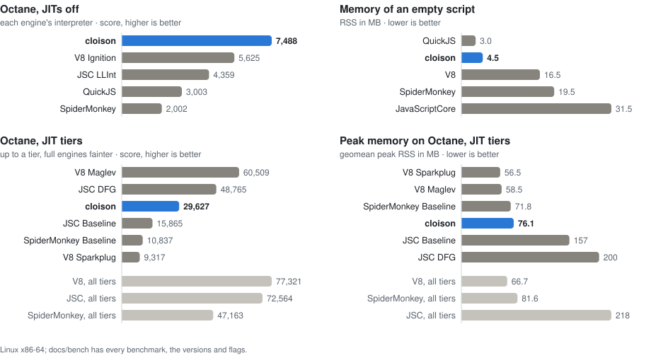

# cloison

[](https://github.com/cesar-kunz/cloison/actions/workflows/ci.yml)
[](https://github.com/cesar-kunz/cloison/actions/workflows/nightly.yml)
[](docs/README-long.md#standards-support)
[](LICENSE)
[](docs/README-long.md)
[](rust-toolchain.toml)

A JavaScript engine in Rust: a register-bytecode interpreter and a
copy-and-patch JIT, in one small static binary.

<picture>
  <source media="(prefers-color-scheme: dark)" srcset="https://raw.githubusercontent.com/cesar-kunz/cloison/bench/chart-dark.svg">
  
</picture>

- **Small**: one 6.4 MB static binary, no other files; an empty script runs
  in 2 ms and 4.5 MB of RSS.
- **The fastest interpreter measured on Octane**: 1.33× V8's Ignition, 1.7×
  JavaScriptCore's LLInt, 2.5× QuickJS, 3.7× SpiderMonkey's interpreter.
- **A copy-and-patch JIT** (x86-64 and arm64) that LLVM writes ahead of
  time: 3× V8's Sparkplug on Octane, ahead of Maglev on DeltaBlue and
  Richards, 5.7× OpenHarmony's ARK JIT (on the six benchmarks it runs).
- **Lean on Octane**: a 74 MB peak with the JIT (V8 67, SpiderMonkey 82,
  JavaScriptCore 218), 50 MB without.
- **Modern JavaScript**: ES5 through ES2026 and most Stage 3 proposals,
  98.4% of test262.
- **Real applications run**: TypeScript's compiler, pdf.js, Excalidraw,
  ECharts, Sass, MathJax and more; interpreted, the fastest interpreter
  measured: 1.14× V8's Ignition, 2.9× SpiderMonkey's interpreter.
- **A generational, concurrent collector** that evacuates fragmented blocks.
- **Numbers match V8's bit for bit** (fdlibm `Math`, shortest round-trip
  printing), but for `pow`, within one ulp of it.
- **Linux** (x86-64, arm64) and **macOS** on Apple silicon; nightly Rust,
  one crate whose only runtime dependency is `libc`.

```sh
cargo build --release
target/release/cloison file.js            # prints the completion value
target/release/cloison --module main.mjs  # a module
target/release/cloison --dump file.js     # the bytecode
```

## Against other engines

Octane on Linux x86-64 (higher is better; geomeans over its 15 benchmarks):

| | cloison | V8 | JavaScriptCore | SpiderMonkey | QuickJS |
|---|---:|---:|---:|---:|---:|
| without a JIT | **7,503** | 5,625 | 4,359 | 2,002 | 3,003 |
| with a JIT | 29,549 | 77,321 | 72,564 | 47,163 | — |

Size and memory (lower is better):

| | cloison | V8 | JavaScriptCore | SpiderMonkey | QuickJS |
|---|---:|---:|---:|---:|---:|
| binary, MB | 6.4 | 35.6 + 10.8 ICU | 36.8 + 39 ICU | 44.7 | 2.9 |
| empty script, RSS MB | 4.5 | 16.5 | 31.5 | 19.5 | 3.0 |
| Octane peak RSS, JIT, MB | 74 | 67 | 218 | 82 | — |
| Octane peak RSS, no JIT, MB | 50 | 56 | 108 | 76 | 28 |

The reports, with every benchmark, the engines' versions and flags, ARK
and KetteVM:

- [Octane](docs/bench/octane.md): scores and instruction counts, with and without JITs
- [Real web apps](docs/bench/webapps.md): 15 open-source applications, time and what is still slow
- [Memory](docs/bench/memory.md): sizes, startup, peak RSS
- [V8's tiers](docs/octane-tiers.md): cloison against Ignition, Sparkplug, Maglev and Turbofan over time

## More

- [cloison in depth](docs/README-long.md): how it works, design choices,
  standards support, testing, building, where it falls short
- [docs/gc.md](docs/gc.md): the collector
- [docs/object-model.md](docs/object-model.md): objects, shapes, escape analysis
- [docs/direct-calls.md](docs/direct-calls.md): the call convention
- [docs/sparse-arrays.md](docs/sparse-arrays.md): sparse arrays and their defaults
- [docs/opcode-targets.md](docs/opcode-targets.md) and
  [docs/arm64-targets.md](docs/arm64-targets.md): stencils against handwritten code
- [docs/intl.md](docs/intl.md): the optional `Intl`
- [docs/sandbox.md](docs/sandbox.md): heap sandboxing, deferred
- The commit messages are the design log: each step with what it
  measured.

## License

Licensed under the Apache License, Version 2.0; see `LICENSE`.
